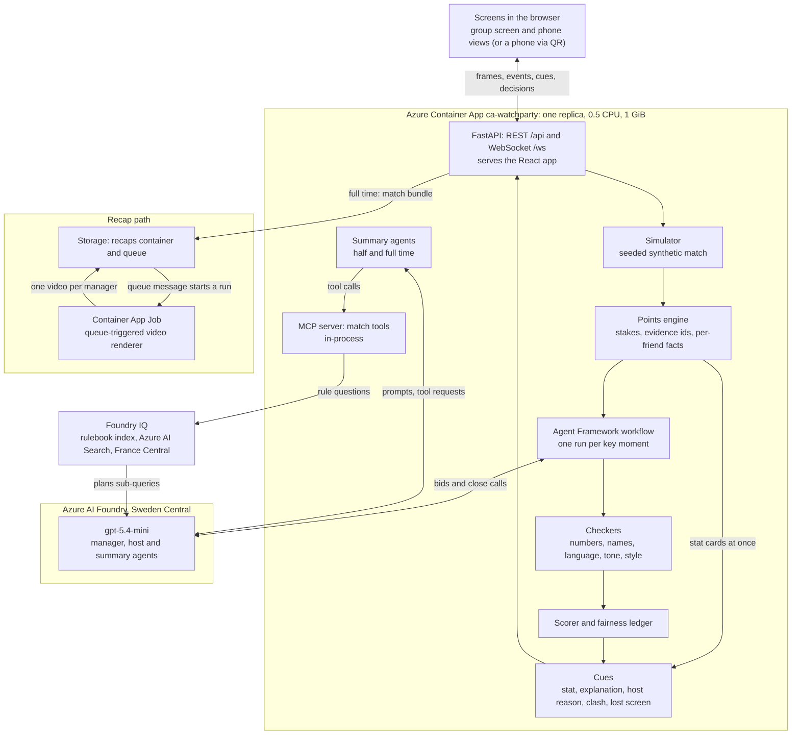
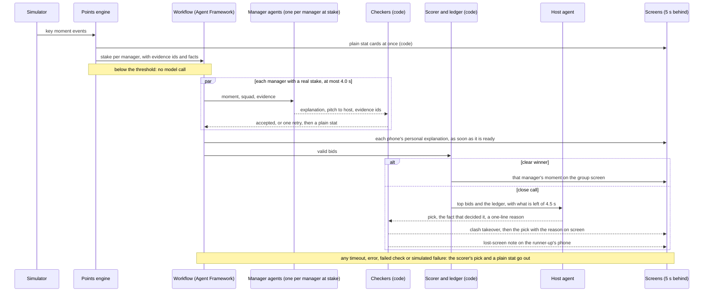
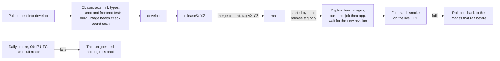

# Architecture

How Couch Gaffer turns one synthetic match into five personal stories, one shared screen and five recap videos. Every number here is read from the code or the infrastructure template, and each section links the files that hold it.

## The system

Sources: [`app/main.py`](../backend/watchparty/app/main.py), [`app/session.py`](../backend/watchparty/app/session.py), [`app/workflow.py`](../backend/watchparty/app/workflow.py), [`infra/main.bicep`](../infra/main.bicep).

## Who decides what

| Decision | Made by | Where |
|---|---|---|
| What happens in the match | The simulator, from a seed | [`sim/engine.py`](../backend/watchparty/sim/engine.py) |
| Every number: points, totals, ranks, xG, facts | The points engine, in code | [`points/engine.py`](../backend/watchparty/points/engine.py) |
| Which managers have a stake worth a model call | Code: 2 IP or more, a rank change, or one save from the Wall tier | [`points/engine.py`](../backend/watchparty/points/engine.py), [`rules_v1.json`](../backend/watchparty/points/rules_v1.json) |
| What a manager's phone says about the moment | That manager's agent, checked by code | [`agents/manager.py`](../backend/watchparty/agents/manager.py) |
| Whether the group screen needs a judgement | The scorer, in code | [`agents/scorer.py`](../backend/watchparty/agents/scorer.py) |
| Who gets the group screen on a close call | The host agent, checked by code | [`agents/host.py`](../backend/watchparty/agents/host.py) |
| What each screen shows, when, and for how long | Code: timed cues | [`app/cues.py`](../backend/watchparty/app/cues.py), [`contracts/schemas/cue.schema.json`](../contracts/schemas/cue.schema.json) |
| Half-time and full-time summaries | One summary agent per manager, using the match tools, checked by code | [`agents/summary.py`](../backend/watchparty/agents/summary.py) |
| Which moments go in each recap | Code | [`recap/plan.py`](../backend/watchparty/recap/plan.py) |

Models write words and make one judgement, the close call. They never produce a number that code has not computed first.

## One key moment, end to end

The screens run 5 s behind the stream (`playback_delay_ms` in [`sim/engine.py`](../backend/watchparty/sim/engine.py)), so every decision about a moment has to be made before the screens reach it. The bids and the host share one 4.5 s budget, counted from when the moment reaches the server ([`docs/decisions/0003-timing.md`](decisions/0003-timing.md)). Within it, a manager agent gets at most 4.0 s and the host at most 2.5 s, each capped by what is left of the 4.5 s. The host is not called at all when less than a quarter of its 2.5 s is left ([`app/workflow.py`](../backend/watchparty/app/workflow.py), defaults in [`app/session.py`](../backend/watchparty/app/session.py)).

Step by step:

1. **Stat cards.** When a key moment's climax arrives, the points engine returns one stake per manager. Code puts a stat card on the group screen and a points card on every phone whose points changed, at once. Each phone's points card is in its manager's language (`+2,5 IP` on a Spanish phone); the group screen stays in English. A goal or a rank change also puts the league table on the group screen ([`app/session.py`](../backend/watchparty/app/session.py) `_stat_cues`, [`app/cues.py`](../backend/watchparty/app/cues.py) `points_headline`).
2. **Stakes and facts.** Each stake carries the moment's points swing, league total, ranks before and after, and an evidence item for every number. It also carries per-friend facts: a differential (a player only this manager owns), a template player (owned by at least three of the five), the extra points from a captain that others own without the armband, a rank change, goal points expected from a shooter's xG against those scored, and the quality of the pass that set up the shot. Each fact's numbers are added to the stake's evidence, so any line written from a fact can pass the number checker ([`points/engine.py`](../backend/watchparty/points/engine.py) `_facts`, [`contracts/schemas/stake.schema.json`](../contracts/schemas/stake.schema.json)).
3. **Bids.** The workflow fans out to one step per manager. A manager whose stake is below the threshold sends nothing and costs nothing. The others ask the manager agent for an explanation in the manager's style and language, a pitch to the host, an urgency from 0 to 1 and the evidence ids it used. An analyst gets every evidence item; a casual fan gets only the points swing, so the model cannot overuse numbers it never sees ([`agents/manager.py`](../backend/watchparty/agents/manager.py)). Each explanation goes to its phone as soon as it is ready, replacing that phone's points card, if it has one.
4. **Scoring.** The scorer ranks the bids: points decide, urgency only nudges, and a fairness weight raises managers who keep losing close calls and lowers those over a fifth of the airtime. A clear winner leads on both points and score by more than 10%; anything else is a close call ([`agents/scorer.py`](../backend/watchparty/agents/scorer.py), [`docs/decisions/0002-group-screen.md`](decisions/0002-group-screen.md)).
5. **Close calls.** The host agent sees each candidate's pitch, impact points, airtime share, close calls lost, and the facts code has verified about them (bigger swing, least airtime, most close calls lost, dead heat, scorer's pick). It must name the fact that decided it, code checks that fact is true for the chosen manager, and the reason may quote only the chosen manager's own numbers ([`agents/host.py`](../backend/watchparty/agents/host.py)).
6. **Group screen.** The chosen manager's pitch, in English, replaces the group stat card. Not the explanation: that speaks to its own manager as "you", and on the shared screen "you" is everyone. The manager agent checks its pitch as a line for the room: it names its manager, says which way the swing went, is a statement rather than an order to the host or the room, never says "you" or "I" (the judge's own manager, "You", is the viewer and may be "you", as in the host's reasons), and carries one fact with at most two numbers ([`agents/checks.py`](../backend/watchparty/agents/checks.py) `room_problems`). When only the pitch fails twice, code's plain line replaces it and the agent's phone text is kept. The workflow itself checks only the angle and the decline. The card's AI or Plain stat mark says who wrote the line (`body_source`), not who decided. When the host decided, its reason goes on screen too ([`app/session.py`](../backend/watchparty/app/session.py) `decide`).
7. **Ledger.** The decision is recorded: airtime for the chosen manager, and one more close call lost for each other bidder on a close call ([`agents/scorer.py`](../backend/watchparty/agents/scorer.py) `Ledger.record`).

## The checks

Everything a model writes passes code checks before any screen shows it ([`agents/checks.py`](../backend/watchparty/agents/checks.py)). A failed answer gets one retry with the problems fed back; a second failure falls back to code ([`agents/foundry.py`](../backend/watchparty/agents/foundry.py) `checked`).

- **Numbers.** Every number in the text, whether written in digits or words, must be the value of an evidence item the answer cited, with its sign and unit, rounded by at most 5%. Loss and gain words give a points figure its sign. A number is read wherever it sits, including next to punctuation or another number, and a run such as `0.31.99` is refused as a whole. Spanish text must use decimal commas.
- **Names.** Every capitalised word must belong to a club, player or manager in this match, or be a short acronym or an ordinary word starting a sentence, so a real player or club name is refused.
- **Tone.** No betting, money or prize language, and no other fantasy game's terms.
- **Language.** No common words of the other language, so English and Spanish are never mixed.
- **Style.** Analyst and casual have different limits on sentences, numbers and length, for explanations and summaries alike.

The host's reason also may not guess a manager's gender ([`agents/host.py`](../backend/watchparty/agents/host.py)). Summaries may cite only evidence and rulebook entries their own tools returned ([`agents/summary.py`](../backend/watchparty/agents/summary.py) `summary_problems`).

## Fallbacks

The match never waits on a model. Each fallback is built by code from the same evidence, so it always passes the checks.

| What fails | What goes out instead | Where |
|---|---|---|
| A manager agent times out, errors, answers out of schema or fails the checks twice | A plain-stat explanation and a plain pitch ("+8 IP for Priya from this moment (goal).") from the stake's own evidence, with neutral urgency 0.5, so urgency neither helps nor hurts it on the group screen | [`agents/base.py`](../backend/watchparty/agents/base.py) `fallback_bid`, [`app/workflow.py`](../backend/watchparty/app/workflow.py) |
| The host times out, errors, fails the checks twice, or has under a quarter of its time left | The scorer's pick, marked `fallback` | [`app/workflow.py`](../backend/watchparty/app/workflow.py) `HostStep` |
| The whole moment fails | The stat cards stay up; the match and its recap go on | [`app/session.py`](../backend/watchparty/app/session.py) `_key_moment` |
| A summary times out (40 s), errors, its tools fail, or it fails the checks | A plain summary from the match tools' own evidence | [`agents/summary.py`](../backend/watchparty/agents/summary.py) `fallback_summary` |
| The recap job fails or is late | No link; the match is unaffected | [`recap/dispatch.py`](../backend/watchparty/recap/dispatch.py) |
| No Foundry endpoint is configured | Every match runs on code alone, and `/health` says so | [`app/main.py`](../backend/watchparty/app/main.py) |

A timeout, an error or a second failed check is logged as a warning with its cause, so a sign-in or quota failure does not look like the design working (spans are marked as errors too, but traces are not exported in this version) ([`app/workflow.py`](../backend/watchparty/app/workflow.py) `fell_back`). A summary's log line names the cause: a timeout, failed checks with the problems, a match tools error, or a model or API error. Agent Framework hands a failed tool call back to the model as a plain error and carries on, so a middleware records each failed tool call and the summary's log line names it first ([`agents/foundry.py`](../backend/watchparty/agents/foundry.py) `record_tool_failures`, [`app/session.py`](../backend/watchparty/app/session.py) `why_summary_fell_back`).

The "knock out" control on the judge's page skips one manager's agent on purpose, the judge's own included, the next time that agent bids: that phone gets the plain stat from code, while the other agents and the host run as usual. It stays armed through moments where that manager has nothing at stake. Each press gets an arm id, and the decision of the moment that spends it carries `knocked_out` with that id, so the page clears its label only when the server has used that press. `POST /api/sessions/{id}/chaos` without a manager still sends every agent on the next moment with agents in it to the code fallbacks ([`app/session.py`](../backend/watchparty/app/session.py) `simulate_failure`, [`app/workflow.py`](../backend/watchparty/app/workflow.py) `ManagerStep`).

## Cues and the close-call takeover

Every screen receives cues: what to show, at which match time, for at least how long, and when it expires. A cue can replace an earlier one, which is how a stat card becomes an explanation without restarting its time on screen. The group screen shows one card at a time for at least 6 s; a phone for at least 4 s ([`app/cues.py`](../backend/watchparty/app/cues.py), [`frontend/src/lib/cues.ts`](../frontend/src/lib/cues.ts)).

A close call settled by the host, or by its fallback, adds two cues ([`app/cues.py`](../backend/watchparty/app/cues.py) `clash_cues`):

- **Clash, on the group screen.** The two contenders' pitches, the chosen manager and the runner-up, take over the whole screen for about one real second. The verdict then takes over for twice as long, and the screen hands back to the pitch with the chosen card and a verdict line ([`frontend/src/lib/cues.ts`](../frontend/src/lib/cues.ts) `clashAt`, [`frontend/src/components/Cards.tsx`](../frontend/src/components/Cards.tsx)).
- **Lost screen, on the runner-up's phone.** A note saying who got the screen and their pitch, timed to the verdict, not before it, and shown in that phone's language.

Clear winners get no clash, and neither does a close call without two pitches.

## Half time and full time

- **Summaries.** At each whistle the match tools' view is frozen, and a summary agent per manager writes that manager's summary, at most three at a time so the burst does not slow the live bids. The agent code runs in the app and is the MCP client: it calls the match tools (standings, squad points, match stats, key moments, player summaries, scoring rules) through an in-process transport whenever the model asks for them. Each agent may cite only evidence it was served, and never evidence about another manager's squad ([`app/session.py`](../backend/watchparty/app/session.py) `_summary`, [`matchtools/`](../backend/watchparty/matchtools/), [`docs/mcp.md`](mcp.md)).
- **Rule explanations.** When Foundry IQ is configured, the summary agent can ask why a moment scored the way it did. The answer comes from the league rulebook index in Azure AI Search, read with the app's managed identity; the search service uses its own identity to plan sub-queries with the model. A summary may cite only rulebook entries its own lookups returned ([`matchtools/rulebook.py`](../backend/watchparty/matchtools/rulebook.py), [`agents/summary.py`](../backend/watchparty/agents/summary.py)).

## The recap path

1. At full time, for a completed match that ran with agents, the app writes the match bundle (frames, stakes, every cue and decision, the final table) to blob storage and puts a message on the `recaps` queue ([`recap/dispatch.py`](../backend/watchparty/recap/dispatch.py), [`recap/bundle.py`](../backend/watchparty/recap/bundle.py), [`recap/storage.py`](../backend/watchparty/recap/storage.py)).
2. The message starts a Container App Job run (4 CPU, 8 GiB, 240 s limit). It plans each manager's recap: their biggest swings first, then moments where they won the group screen, at most five, in match order. Captions are that manager's own phone text, and the end card is their full-time summary ([`recap/plan.py`](../backend/watchparty/recap/plan.py)).
3. It renders the five videos in parallel, vertical 1080 by 1920, about 25 s each, with the video's own labels in the manager's language. It uploads them, writes `done.json` last, then deletes the message. A message that keeps failing is dropped after three tries ([`recap/worker.py`](../backend/watchparty/recap/worker.py), [`recap/render.py`](../backend/watchparty/recap/render.py)).
4. The app polls every 3 s for up to 10 minutes. Once all five are done, it signs a read-only link for each video with a user delegation key and puts it on that manager's phone.

Matches that ran on code alone, were abandoned, or failed get no recap. A failure costs only the link, never the match.

## Running a public demo with no sign-in

The demo is a public link with no sign-in, so the session store caps what anyone can start ([`app/session.py`](../backend/watchparty/app/session.py) `SessionStore`, [`app/main.py`](../backend/watchparty/app/main.py)):

- at most 20 matches at once, and 4 from one address
- at most 8 matches an hour from one address; past that, a new match is refused with "busy"
- of those, at most 4 an hour with agents; the rest run on code alone
- at most 30 sessions created an hour from one address
- past 60 agent matches an hour across everyone, new matches run on code alone, so the site stays up and model use has a ceiling
- an abandoned match that never started a model call or a rulebook lookup gives its agent slot back; one that did keeps it
- an unopened session frees its seat after 30 s, and one address holds at most one unopened session
- a match nobody watches for 30 s stops, with no recap
- request bodies over 4 KB are refused, a session takes at most 18 screens, and a screen that stops reading for 10 s is closed
- the MCP endpoint is off on the public app unless `MCP_PUBLIC=1`

## Measuring the arbitration

[`backend/tools/evidence.py`](../backend/tools/evidence.py) runs three strategies on the same key moments with the same eligible managers: the production workflow (manager agents, scorer, ledger, host), one model call per moment that writes every explanation and picks the screen, and greedy code where the biggest swing always wins. Both model strategies get the same checks, one retry and the 4.5 s budget. One run covers 50 seeds with stub agents and no model calls; a second runs a held-out sample against the real model. The results of one run, with its method and limits, are in [evidence.md](evidence.md).

## Azure

| Resource | Role |
|---|---|
| Container App `ca-watchparty` | The app: API, WebSockets, simulator, agents, MCP tools and the built front end. One replica, HTTPS only |
| Container Apps environment `cae-watchparty` | Consumption plan; sends all its log categories to Log Analytics |
| Container App Job `caj-watchparty-recap` | Recap renderer, started by the storage queue, up to 5 runs at once |
| Container registry `watchpartyd4d84f` | App and recap images, tagged with the commit, and with the release version when deployed by script; admin user off |
| Azure AI Foundry account and project | `gpt-5.4-mini` for every agent; `gpt-4.1-mini` deployed as the tested runner-up ([`docs/decisions/0001-models.md`](decisions/0001-models.md)) |
| Azure AI Search (Foundry IQ), France Central | Rulebook index for rule explanations; Sweden Central takes no new search services |
| Storage account | Recap bundles and videos, and the job queue; no public blob access, no shared keys, recaps deleted after 30 days |
| Log Analytics `log-watchparty` | The environment's logs, 30 days, 1 GB daily cap |
| Managed identities | One each for the app, the recap job and deploys, plus the search service's own identity for planning queries with the model. No keys or connection strings anywhere: Foundry, Search and Storage all have key access switched off |

Everything above is one Bicep template, [`infra/main.bicep`](../infra/main.bicep), except the Foundry account, its project and its deployments, which the template references ([`infra/README.md`](../infra/README.md) says why).

Each identity holds only what it needs:

- **App:** pull its image, call the models, read the rulebook, read and write the recaps container, send queue messages, and sign read-only recap links.
- **Recap job:** pull its image, read and write the recaps container, and take and delete messages on the recaps queue.
- **Deploy:** push images, update the app and the job, and read and join their environment through a custom role. It signs in only from `main`, and cannot assign roles or touch Foundry or storage.

## Delivery

- `develop` is the integration branch. `main` holds only releases: a `release/X.Y.Z` branch merged with a merge commit and tagged `vX.Y.Z` ([`infra/README.md`](../infra/README.md), Deploying; [`CHANGELOG.md`](../CHANGELOG.md)). A pre-push hook refuses pushes to `main`, `develop` and release tags unless the integrator sets an override ([`.githooks/pre-push`](../.githooks/pre-push)).
- CI runs on every pull request and every push to `main` ([`.github/workflows/ci.yml`](../.github/workflows/ci.yml)).
- A deploy restarts the single replica and ends every live match, so nothing deploys on a merge. The deploy workflow runs only when started by hand on `main` ([`.github/workflows/deploy.yml`](../.github/workflows/deploy.yml)), and [`scripts/deploy.sh`](../scripts/deploy.sh) does the same from a laptop after `make check`. Both refuse any commit that is not the tip of `main` on origin with exactly one `vX.Y.Z` tag there ([`scripts/release_tag.sh`](../scripts/release_tag.sh)).
- The deploy waits for the new revision to be healthy and serving the image just pushed before the smoke, so the smoke cannot pass against the old revision. If anything after the roll fails, or the run is stopped, both the app and the job go back to the images they ran before ([`infra/README.md`](../infra/README.md), Deploying).
- GitHub Actions signs in to Azure with a short-lived OIDC token for one managed identity. No Azure secret is stored in GitHub. The daily smoke needs no Azure access at all ([`.github/workflows/smoke.yml`](../.github/workflows/smoke.yml)).
- The smoke plays a whole match on the live site and fails without group-screen decisions, an explanation and a summary written by an agent, all ten summaries, a rulebook citation, Spanish text from an agent with its English copy, and all five recap links serving video ([`backend/tools/smoke.py`](../backend/tools/smoke.py)).

## Limits today

- **One replica.** A live match is a running task in the server's memory, so a deploy or a crash ends the matches in progress, and every visitor shares one 0.5 CPU container ([`infra/main.bicep`](../infra/main.bicep)).
- **Synthetic matches only.** Clubs, players and managers are invented; real match data would need a licensed feed.

## Not in this version

- Shared live state in Redis for several replicas
- Leagues, squads and seasons in PostgreSQL
- Traces exported to Application Insights
- Manager angles and declined bids (the contracts define a declined bid; nothing sends one yet)
